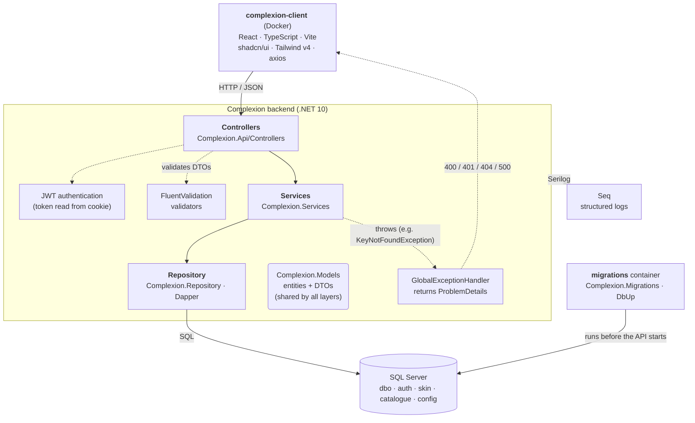
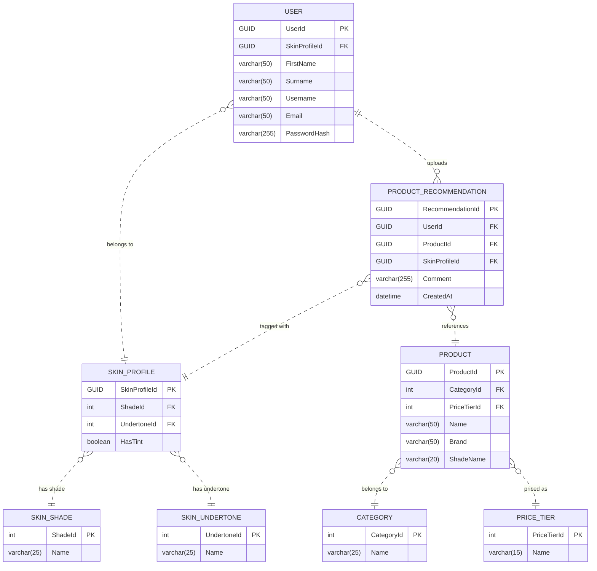

# Complexion

Complexion is a community-based skin shade and undertone matcher for makeup. Users create a skin profile (shade, undertone, whether they prefer a tint) and share product recommendations that worked for their complexion, so others with a similar profile can find their match.

This is a full-stack project: a .NET 10 Web API with an N-tier architecture, backed by SQL Server via Dapper, with a React + TypeScript client. Every part runs in Docker.

## Architecture



**How a request flows:** controllers stay thin. Requests are authenticated with a JWT (read from a
cookie), and endpoints require an authenticated user by default. Controllers hand off to services,
which hold the business logic and throw standard .NET exceptions (for example `KeyNotFoundException`
when a record doesn't exist). `GlobalExceptionHandler` maps those to the right status code and a
`ProblemDetails` body, so controllers don't do manual null checks. Repositories are the only layer
that talks to the database (Dapper, parameterised SQL).

## Data model



The migration scripts in `Complexion/Complexion.Migrations/Scripts` are the source of truth for the schema. Each diagram entity maps to a table like this:

| Diagram entity | Table |
| --- | --- |
| `USER` | `auth.User` |
| `SKIN_PROFILE` | `dbo.SkinProfile` |
| `PRODUCT` | `dbo.Product` |
| `PRODUCT_RECOMMENDATION` | `dbo.ProductRecommendation` |
| `SKIN_SHADE` | `skin.Shade` |
| `SKIN_UNDERTONE` | `skin.Undertone` |
| `CATEGORY` | `catalogue.Category` |
| `PRICE_TIER` | `config.PriceTier` |

`SKIN_PROFILE` also has a unique constraint on (`ShadeId`, `UndertoneId`, `HasTint`), so each shade, undertone and tint combination exists only once and is shared by the users and recommendations that use it.

## Tech stack

| Area | Technology |
| --- | --- |
| Backend | .NET 10, C#, Dapper, FluentValidation, Serilog |
| Auth | JWT bearer authentication |
| Database | SQL Server, DbUp migrations |
| Logging | Serilog to [Seq](https://datalust.co/seq) |
| API docs | Swagger / Swashbuckle |
| Frontend | React, TypeScript, Vite, shadcn/ui, Tailwind CSS v4, React Router, axios |
| Backend tests | NUnit, NSubstitute |
| Frontend tests | Vitest, jsdom, React Testing Library |
| End-to-end and API tests | Cypress (Page Object Model), Postman |
| Tooling | Docker, Docker Compose, GitHub Actions |

## Repository layout

```text
.
├── Complexion/                # .NET solution (Complexion.sln) and the API Dockerfile
│   ├── Complexion.Api/        # Controllers, validators, middleware, Program.cs
│   ├── Complexion.Services/   # Business logic, auth, token service
│   ├── Complexion.Repository/ # Dapper data access
│   ├── Complexion.Models/     # Entities and DTOs
│   ├── Complexion.Exceptions/
│   ├── Complexion.Migrations/ # DbUp scripts, with its own Dockerfile
│   └── Complexion.Tests/      # NUnit tests
├── complexion-client/         # React + TypeScript client, with its own Dockerfile
│   └── cypress/               # End-to-end tests and page objects
├── Postman/                   # API collection and local environment
├── docker-compose.yml         # sql, seq, migrations, api, client
└── .github/workflows/
    └── complexion-ci.yml      # CI pipeline
```

## Getting started

### Prerequisites

- Docker and Docker Compose
- .NET 10 SDK (only needed to run backend tests)
- Node.js and npm (only needed to run the client outside Docker or run its tests)

### Configure the environment

`docker-compose.yml` reads three variables. Create a `.env` file in the repo root (it is not committed) and set:

```text
SA_PASSWORD=<a strong SQL Server password>
ACCEPT_EULA=Y
JWT_KEY=<a long random secret used to sign tokens>
```

### Run everything with Docker

```bash
docker compose up --build
```

| Service | What it does | URL |
| --- | --- | --- |
| `sql` | SQL Server 2022 | `localhost:1433` |
| `migrations` | Applies the DbUp scripts, then exits. The API waits for it to finish. | n/a |
| `api` | The .NET API (Development environment, so Swagger is enabled) | <http://localhost:8080/swagger> |
| `seq` | Log viewer | <http://localhost:8081> |
| `client` | React client (Vite dev server, source mounted for hot reload) | <http://localhost:5173> |

### Run the client outside Docker (optional)

```bash
cd complexion-client
npm install
npm run dev
```

## Testing

```bash
# Backend (NUnit)
dotnet test Complexion/Complexion.sln

# Frontend unit and component tests (Vitest)
cd complexion-client
npm run test:run
```

Backend tests follow a `GIVEN_WHEN_THEN` naming convention and use `Assert.Multiple` where a test has more than one assertion.

End-to-end tests live in `complexion-client/cypress` and use the Page Object Model. The API collection is in `Postman/`.

## CI

`.github/workflows/complexion-ci.yml` runs on pushes and pull requests to `main`:

- **build-and-check**: restore, build, `dotnet test`, `dotnet format --verify-no-changes`, and a vulnerable-package check
- **super-lint**: Super-Linter for the file types `dotnet format` doesn't cover
- **frontend-check**: `npm ci`, `npm run test:run` and `npm run build` on Node 22
- **docker-build**: runs after the three jobs above and builds the API image, tagged with the run number (it is not pushed to a registry)

## Conventions

- N-tier layering: Controllers → Services → Repository, with models and DTOs in `Complexion.Models`
- Dapper for data access (no EF Core)
- Errors are thrown from services and handled centrally; no manual null checks in controllers
- Semantic commit messages and a feature-branch workflow
